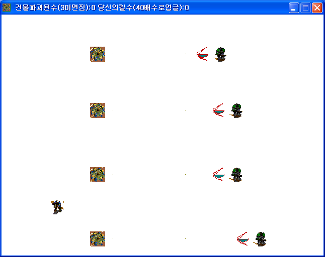

# Photon Cannon Defense

A StarCraft themed defense game where you protect Photon Cannons from waves of Marines and Wraiths. It was made to check whether drag selection and move orders could be done.

  

## How to play

Download from Releases and run it.

Drag with the left button to select several Zealots at once and right click to give a move order. Marines and Wraiths keep coming, so keep the Photon Cannons from being destroyed.

Losing 3 buildings is a defeat. At 40 kills you get extra resources and a Zealot, and at 80 kills the enemies switch to Wraiths. Destroyed buildings and kills are shown in the window title bar.

## How it works

Drag selection is two global variables and coordinate comparisons. When the mouse button goes down, that point's x and y are stored in globals and the selection box is drawn. When the button is released, every Zealot compares its own coordinates against the stored point and the current mouse point, four checks for each drag direction, and if it passes it changes itself into the selected Zealot object.

Selection is not held in a variable but expressed by object type.

## Files

| Path | Contents |
|---|---|
| `source/photon-cannon-defense.gmk` | Original project file |
| `source/split/` | Text tree produced by GmkSplitter |
| `docs/screenshots/` | Screenshots |
| Releases | Distributed build |

## License

CC BY-NC-ND 4.0. Unmodified copies may be shared for noncommercial purposes with attribution. Modified versions and commercial use are not allowed. Bundled libraries, graphics, sounds, and maps made by other people keep their own rights. See [LICENSE](LICENSE).
